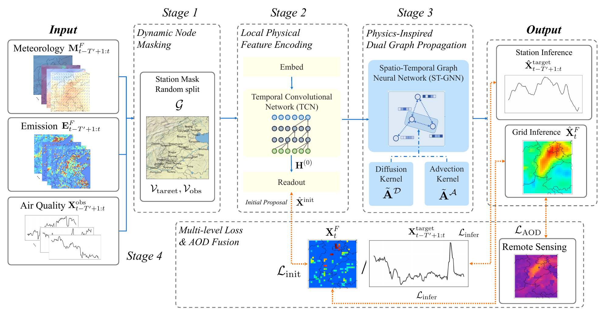

# SPIN

Model and loss code for **Physics-inspired inductive spatiotemporal kriging for PM2.5 with satellite gradient constraints**, Atmospheric Environment (2026), DOI: [10.1016/j.atmosenv.2026.122398](https://doi.org/10.1016/j.atmosenv.2026.122398).

- **[model.py](model.py)**: `SPIN`, `TemporalConvBlock`, `PhysicsInspiredGraphConv`, and diffusion/advection operators.
- **[loss.py](loss.py)**: `masked_l1_loss`, `aod_spatial_gradient_loss`, and the composite `spin_loss` objective.

Dependencies: PyTorch, NumPy and einops. Function docstrings describe tensor shapes, masks and units. Loss inputs must already be standardized; normalization statistics and masks are supplied by the caller. AOD is used only by the auxiliary loss, not by the model forward pass.

Code license: [Apache-2.0](LICENSE).
